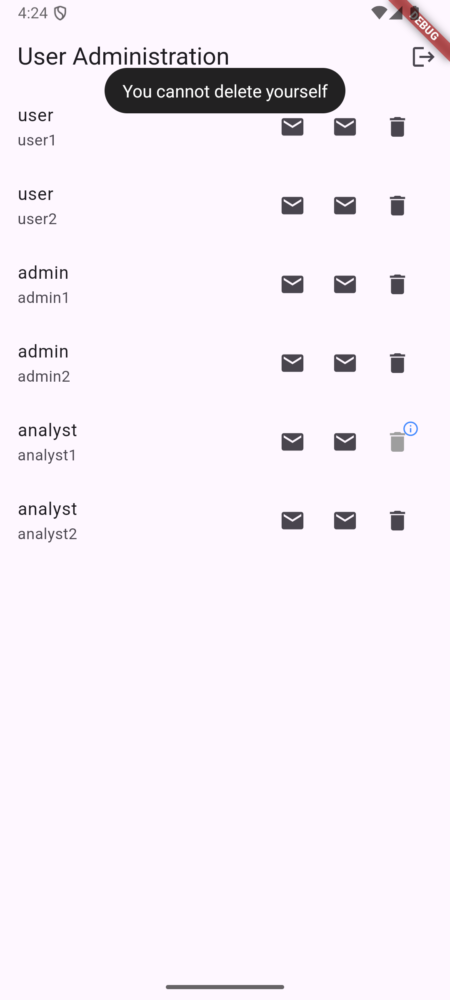
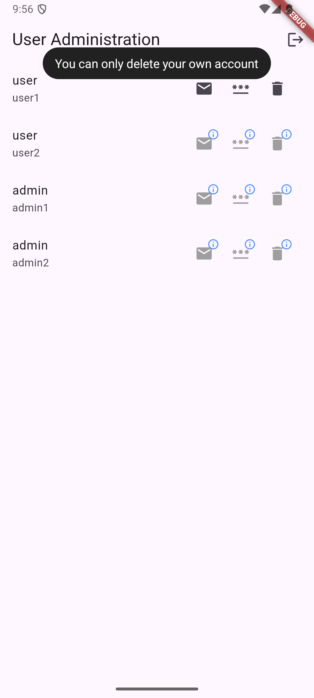
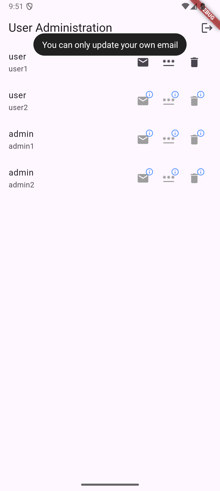
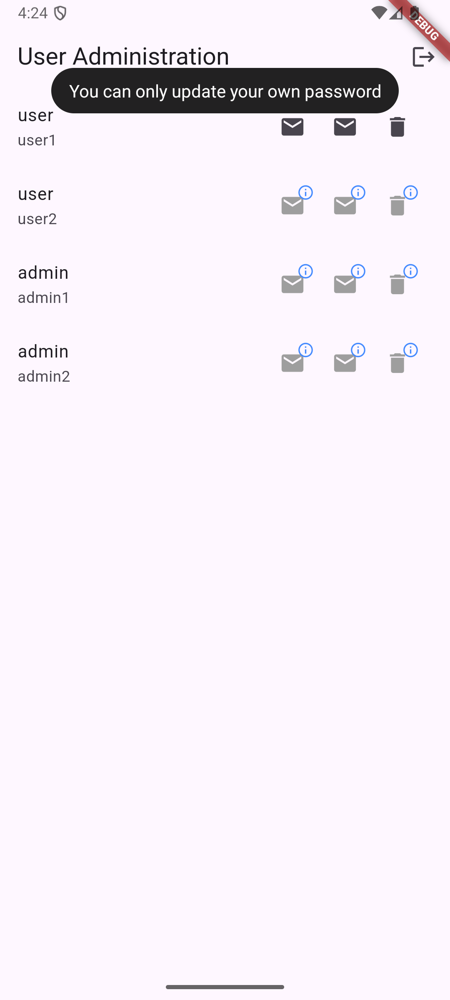
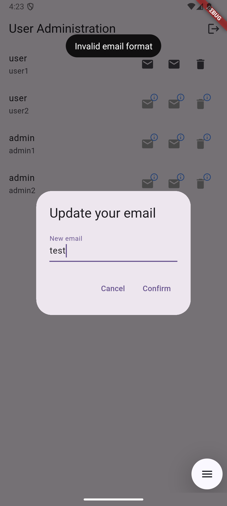
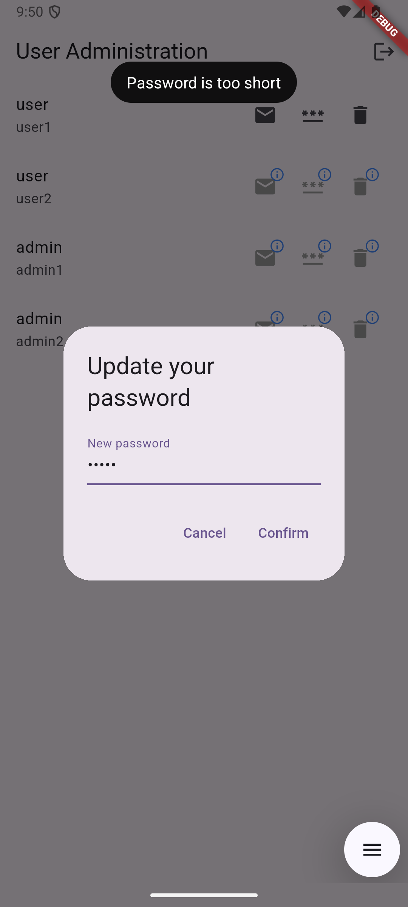

# DDD-Policies-Project

## Introduction
I'm interested in how domain-driven design (DDD) policies can be used to centralize business logic in full-stack applications. 
To explore this I've developed an Android app with a user administration domain. 
The end result could serve as a practical example of how DDD-policies can be used to define and enforce business logic.

## Description
The project is organized as a Melos monorepo. 
It includes a Flutter client using BLoC for state management, with extensive BLoC and integration test coverage. 
The server was built with Shelf using in-memory databases, including some API tests. 
The project has a shared domain package implemented on both the client and server-side, including full unit-testing. 
Other packages include utilities for API management, mapping and testing.

Aside from the domain modeling, some advanced features were developed, such as automated test server fixtures for running isolated integration tests.

By working on this project I've learned more about the challenges and potential benefits of building a full-stack application with policy based business logic. It's also been good for learning about integration testing in Flutter.

## Project Structure
```
apps/
	client/         # Flutter Android app
	server/         # Shelf app
packages/
	domain/         # Shared entities, services and policies etc
	api_error_codes/# API error codes, base exceptions
	http_api/       # HTTP API client utility
	test_utils/     # Test fixtures, runners, mocks, server utilities etc
	mappers/        # Model mappers
```

## UI Examples
<p align="center">
  
  
  
  
  
  
</p>

## How to Run Locally

1. **Clone the project**
	```sh
	git clone https://github.com/JohanMarcolin/DDD-Policies-Project.git
	```

2. **Set up your development device**
	- Install [Android Studio](https://developer.android.com/studio) and set up an emulator. Follow the official [Flutter Android setup guide](https://docs.flutter.dev/get-started/install/windows#android-setup).

3. **Install dependencies for all packages/apps**
	```sh
	melos run bootstrap
	```

4. **Build the required env configuration for all packages/apps**
	```sh
	melos run env_build
	```

5. **Start the server**
	```sh
	dart run apps/server/lib/application/main.dart
	```
6. **Select your Flutter Device**
	- Using VSCode with Flutter installed, select your Android emulator as your *Flutter device*. Alternatively, generate a *launch.json* file and pass the emulator name as an argument.

7. **Start the client**
	- Manually run the client's *main.dart*, or run your *launch.json* file.

8. **Login to a test account**
	 ```
	 User account:
	 { email: "user1", password: "user1" }

	 Admin account:
	 { email: "admin1", password: "admin1" }

	 Analyst account:
	 { email: "analyst1", password: "analyst" }
	 ```

**Run tests**
- **Server tests:**
  ```sh
  melos run server_api_test
  ```
- **Client presentation integration tests**
  ```sh
  melos run client_presentation_integration_test
  ```
- **Client e2e integration tests**
  ```sh
  melos run client_e2e_integration_test
  ```
- **Domain unit tests:**
  ```sh
  melos run domain_unit_test
  ```